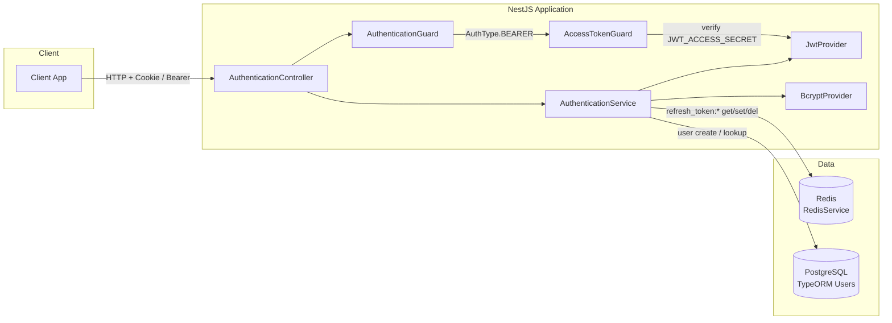
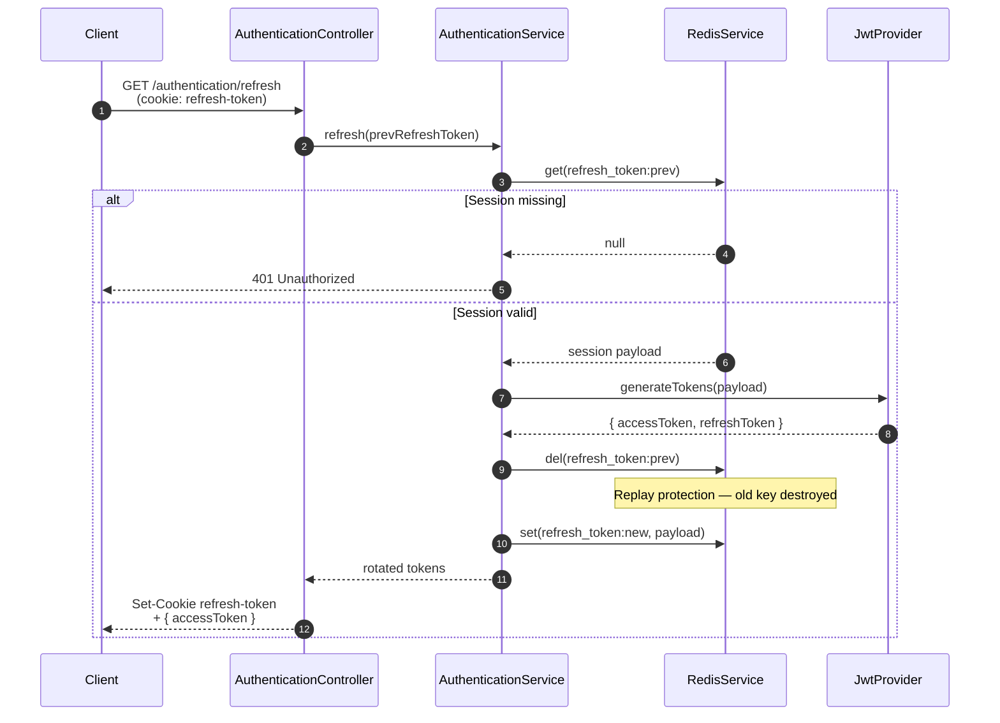

# NestJS Authentication Boilerplate

[](https://nestjs.com/)
[](https://www.typescriptlang.org/)
[](https://redis.io/)
[](https://typeorm.io/)
[](https://jwt.io/)
[](https://swagger.io/)

### Enterprise-grade dual-token authentication — lean, Redis-accelerated, and production-ready out of the box.

---

## Overview & Why This Is The Best

Authentication is the one layer every serious product must get right. This boilerplate solves it once — with a **dual-token JWT architecture**, a **custom generic `RedisService`**, and **zero-database refresh session caching** — so you ship features instead of reinventing security.

**Why this exact setup powers 99.9% of apps:**

| Strength | What it delivers |
| --- | --- |
| **Blazing-fast Redis** | Refresh lookups and rotations hit in-memory Redis via a typed `get` / `set` / `del` cache layer — not your primary database. |
| **Zero DB bottlenecks** | User identity lives in PostgreSQL; session refresh payloads live in Redis. High-frequency `/authentication/refresh` traffic never touches the DB. |
| **Horizontal scalability** | Stateless access JWTs + shared Redis sessions scale cleanly across instances. |
| **Enterprise OWASP posture** | `HttpOnly` cookies, Bearer access verification, single-use refresh rotation with `redis.del` replay defense — without over-engineering. |

Build startups on it. Scale large systems with it. This is the lean, bulletproof engineering standard.

---

## Core Architecture & Security Patterns

### 1. Zero-DB Redis Session Caching

On register and login, a signed refresh JWT is issued and its session payload is cached in Redis under:

```text
refresh_token:<refreshJwt>
```

Payloads include session metadata (`userId` / `email` / `createdAt`) with a **7-day TTL** (`604800` seconds). Refresh verification resolves entirely from Redis — **no database round-trip** on the hot path.

The generic `RedisService` implements `ICacheManager`:

| Method | Role |
| --- | --- |
| `get<T>(key)` | Typed read with JSON parse |
| `set<T>(key, value, ttlSeconds?)` | Write with optional `EX` TTL |
| `del(key)` | Immediate key destruction |

### 2. Single-Use Token Rotation & Theft / Replay Defense

Every successful refresh is a **one-shot rotation**:

1. Lookup the current refresh cookie against Redis.
2. Mint a new access + refresh token pair via `JwtProvider`.
3. **`redis.del`** the previous `refresh_token:<oldJwt>` key.
4. `redis.set` the new session under `refresh_token:<newJwt>`.

A stolen or replayed refresh token finds an empty key and is rejected with `UnauthorizedException`. Rotation + deletion is the replay firewall — elegant, atomic, and fast.

### 3. XSS-Resistant `HttpOnly` Cookie Architecture

- **Access token** — returned in the JSON body (`accessToken`); clients send `Authorization: Bearer <token>`.
- **Refresh token** — delivered in the `refresh-token` cookie via `cookie-parser`, with login setting `{ httpOnly: true, sameSite: "strict" }`.
- **Logout** — clears the cookie and `redis.del`s the session key in one clean cut.

JavaScript on the page never needs to touch the refresh credential. Access stays short-lived and Bearer-verified; refresh stays cookie-bound and Redis-gated.

---

## Visual Architecture Diagrams

### System Data Flow



### Token Rotation & Security Sequence



---

## Tech Stack & Modular Structure

| Layer | Technology |
| --- | --- |
| Runtime | NestJS 11 · TypeScript 5.7 |
| Auth | `@nestjs/jwt` · Dual secrets (`JWT_ACCESS_SECRET` / `JWT_REFRESH_SECRET`) |
| Sessions | Redis via `ioredis` · custom `RedisService` |
| Persistence | PostgreSQL · TypeORM |
| Cookies | `cookie-parser` · `HttpOnly` refresh cookie |
| Passwords | Abstract `HashingProvider` → `BcryptProvider` |
| Docs | Swagger (`/api/docs`) · Compodoc (`npm run doc`) |

```text
src/
├── main.ts                          # cookie-parser, ValidationPipe, Swagger
├── app.module.ts                    # Config, TypeORM, global AuthenticationGuard
├── authentication/
│   ├── authentication.controller.ts # register / login / refresh / logout
│   ├── authentication.service.ts    # Redis session + rotation + bcrypt flows
│   ├── authentication.module.ts     # JwtModule + providers
│   ├── decorators/auth.decorator.ts # @Authentication(AuthType)
│   ├── dto/                         # RegisterDTO · LoginDTO
│   ├── enums/                       # AuthType (BEARER | NONE) · providers
│   ├── guards/
│   │   ├── authentication.guard.ts  # Global strategy router
│   │   └── access-token/...         # Bearer JWT verification
│   └── provider/
│       ├── jwt.provider.ts          # Dual-token mint + verify
│       ├── hashing.provider.ts      # Abstract hash contract
│       └── bcrypt.provider.ts       # bcrypt implementation
├── redis/
│   ├── redis.module.ts
│   ├── redis.service.ts             # Generic get / set / del
│   └── interfaces/                  # ICacheManager
└── users/
    ├── entities/user.entity.ts      # Durable identity store
    └── provider/find-user.provider.ts
```

---

## API Documentation & Architecture Docs

| Document | URL |
| --- | --- |
| **Swagger Docs** | [http://localhost:3000/api/docs](http://localhost:3000/api/docs) |
| **Compodoc Architecture Docs** | [http://localhost:3000/docs](http://localhost:3000/docs) |

Generate and serve Compodoc locally with:

```bash
npm run doc
```

---

## Getting Environment Ready & Quick Start

### 1. Prerequisites

- Node.js 20+
- PostgreSQL
- Redis (default port `6379`)

### 2. Clone & install

```bash
git clone <your-repo-url>
cd nestjs-auth-template
npm install
```

### 3. Configure environment

Copy the example file and fill in your values:

```bash
cp .env.example .env
```

### 4. Run

```bash
# development (watch mode)
npm run start:dev

# production build
npm run build && npm run start:prod
```

The API listens on `PORT` (default **3000**).

---

## API Endpoints Reference

Base path: **`/authentication`**  
All auth routes are public via `@Authentication(AuthType.NONE)`. Protected routes elsewhere default to Bearer via the global `AuthenticationGuard`.

| Method | Endpoint | Auth | Description |
| --- | --- | --- | --- |
| `POST` | `/authentication/register` | Public | Create user (bcrypt hash), issue dual tokens, set `refresh-token` cookie, return `{ accessToken }` |
| `POST` | `/authentication/login` | Public | Validate credentials, issue dual tokens, set `HttpOnly` + `sameSite: strict` cookie, return `{ accessToken }` |
| `GET` | `/authentication/refresh` | Cookie | Rotate refresh via Redis `get` → `del` → `set`, return new `{ accessToken }` |
| `POST` | `/authentication/logout` | Cookie | Clear `refresh-token` cookie and `redis.del` the session key |

### Request bodies

**Register** — `RegisterDTO`

```json
{
  "firstName": "Ada",
  "lastName": "Lovelace",
  "email": "ada@example.com",
  "password": "your-secure-password"
}
```

**Login** — `LoginDTO`

```json
{
  "email": "ada@example.com",
  "password": "your-secure-password"
}
```

### Token contract

| Token | Transport | Verification |
| --- | --- | --- |
| **Access** | `Authorization: Bearer <token>` / JSON `accessToken` | `AccessTokenGuard` → `JwtProvider.verifyToken` with `JWT_ACCESS_SECRET` |
| **Refresh** | Cookie `refresh-token` | Redis session presence + single-use rotation on refresh |

---

## License

UNLICENSED — private template. Adapt freely for your product.
